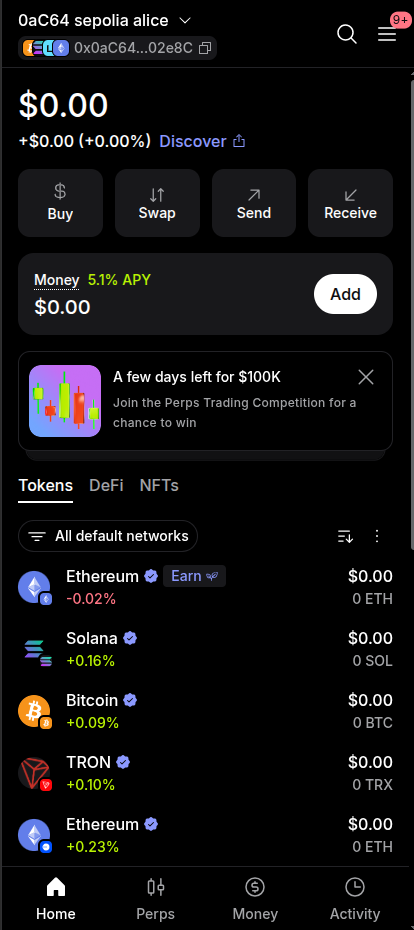
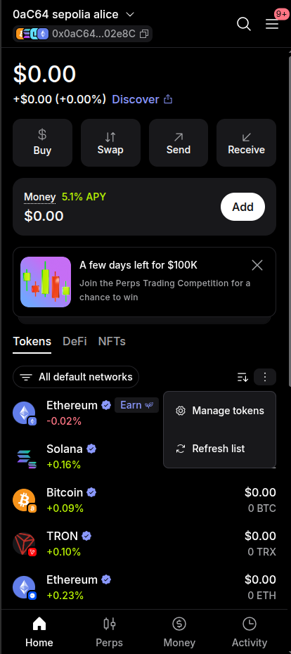
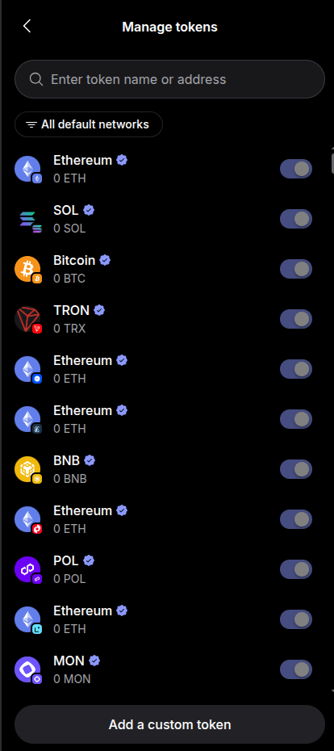
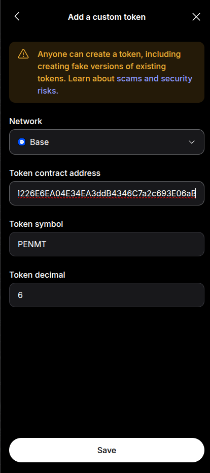

🇪🇸 [Leer en español](agregar-token-personalizado-metamask-base.md)

# Add a custom token to MetaMask on Base

This guide shows how to add a Mettal token (example: **PENMT**) to MetaMask on the **Base** network, so it shows up in your token list. It assumes you already have MetaMask installed and set up.

**Token details (Base Mainnet)**

| Field | Value |
| --- | --- |
| Network | Base |
| Token contract address | `0x862a1226E6EA04E34EA3ddB4346C7a2c693E06aB` |
| Token symbol | `PENMT` |
| Token decimal | `6` |

You can confirm these details on [BaseScan](https://basescan.org/token/0x862a1226E6EA04E34EA3ddB4346C7a2c693E06aB).

---

## Step 1: Open MetaMask on the Tokens tab

Open MetaMask and make sure you're on the **Tokens** tab of the home screen.

## Step 2: Open the token options menu

Tap the **three-dot menu** (⋮) on the right side of the Tokens list, then choose **Manage tokens**.

## Step 3: Choose "Add a custom token"

On the **Manage tokens** screen, tap **Add a custom token** at the bottom.

## Step 4: Enter the token details and save

1. Under **Network**, select **Base**.
2. Paste the **Token contract address**: `0x862a1226E6EA04E34EA3ddB4346C7a2c693E06aB`
3. Check that **Token symbol** shows `PENMT` and **Token decimal** shows `6`. They usually fill in automatically after you paste the address. If they don't, type them in.
4. Tap **Save**.

That's it. **PENMT** now appears in your Tokens list on Base.

---

## Tips

- **Only use the official address.** Anyone can create a token with the same name or symbol, which is why MetaMask shows a warning on this screen. Always copy the contract address from this guide or another official Mettal source.
- **Don't see the token?** Make sure the network filter at the top of the Tokens list includes Base, then use **Refresh list** from the same three-dot menu.
- **Symbol or decimals didn't fill in?** Double-check that **Base** is selected as the network and that the address was pasted in full.
