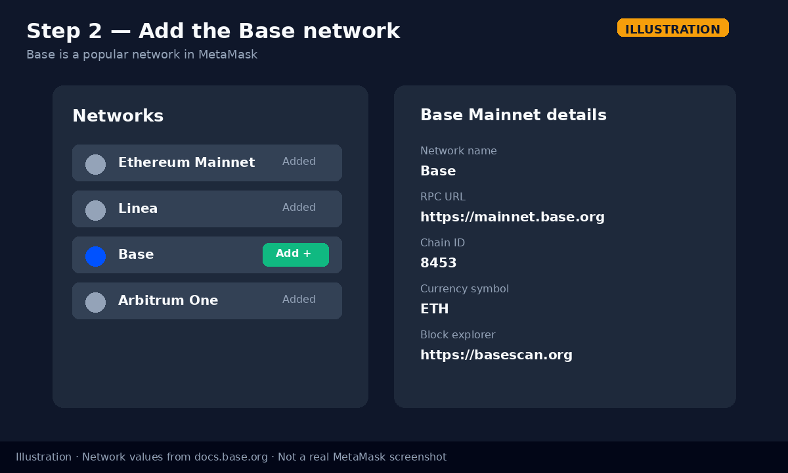
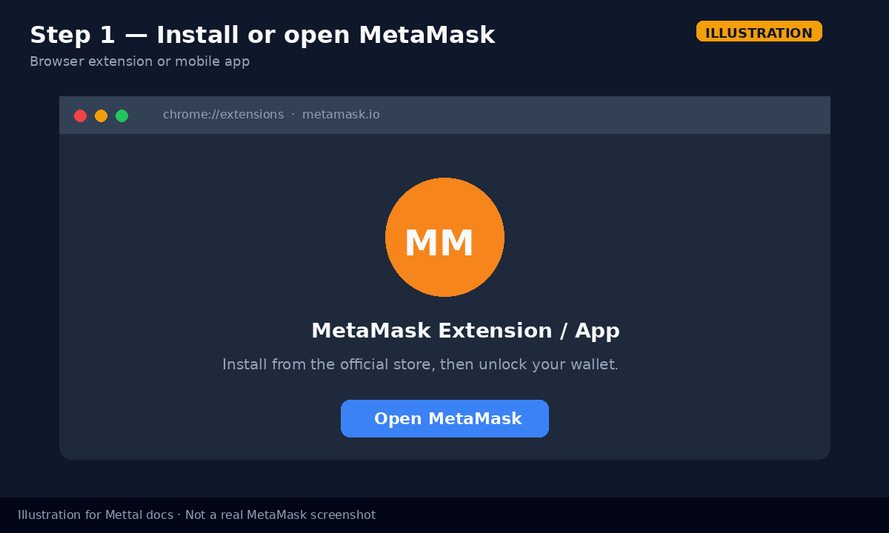
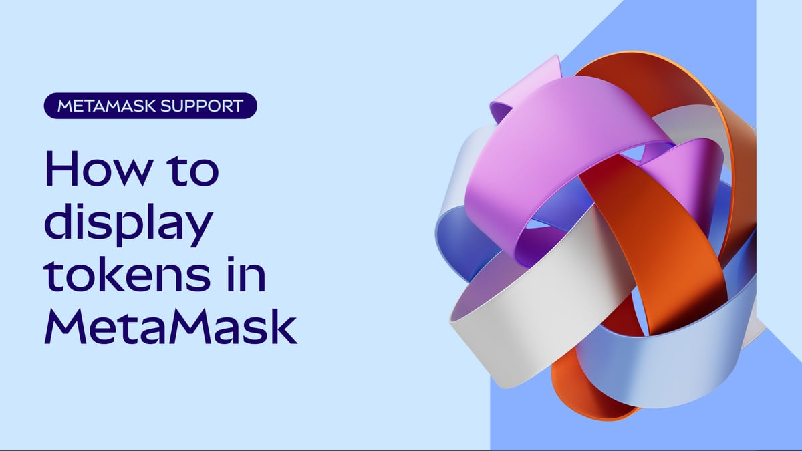
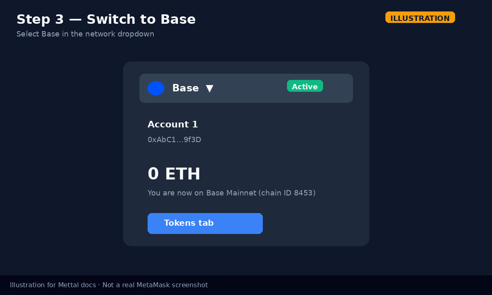
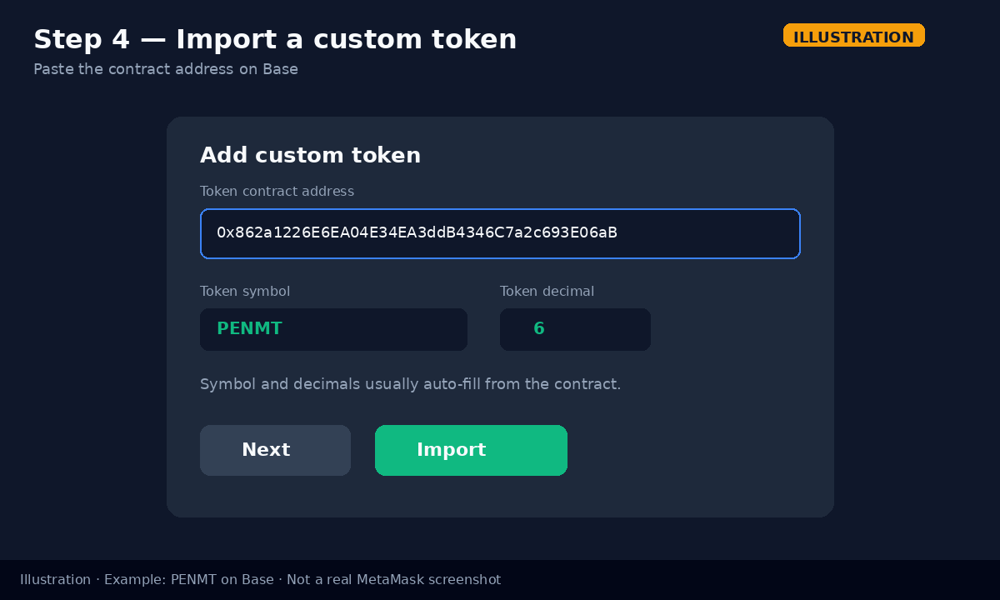
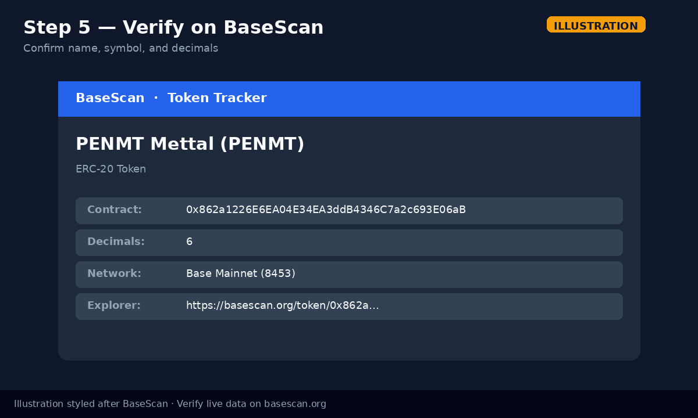
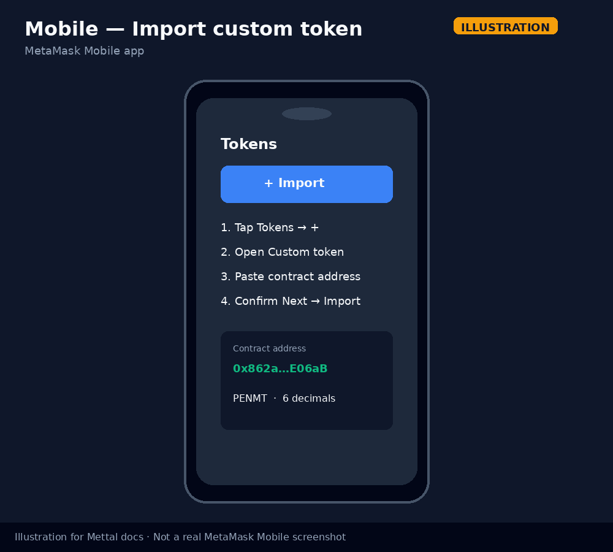
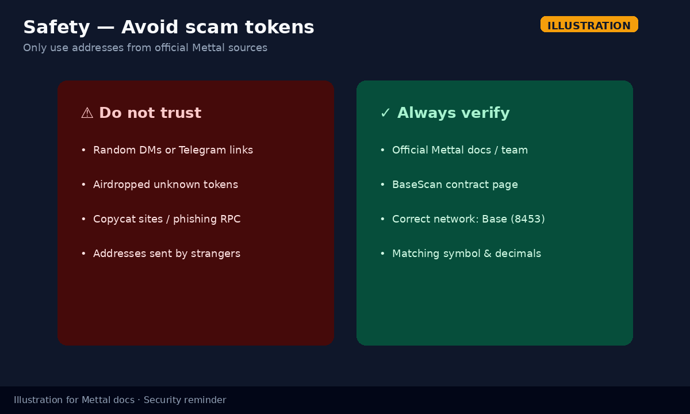
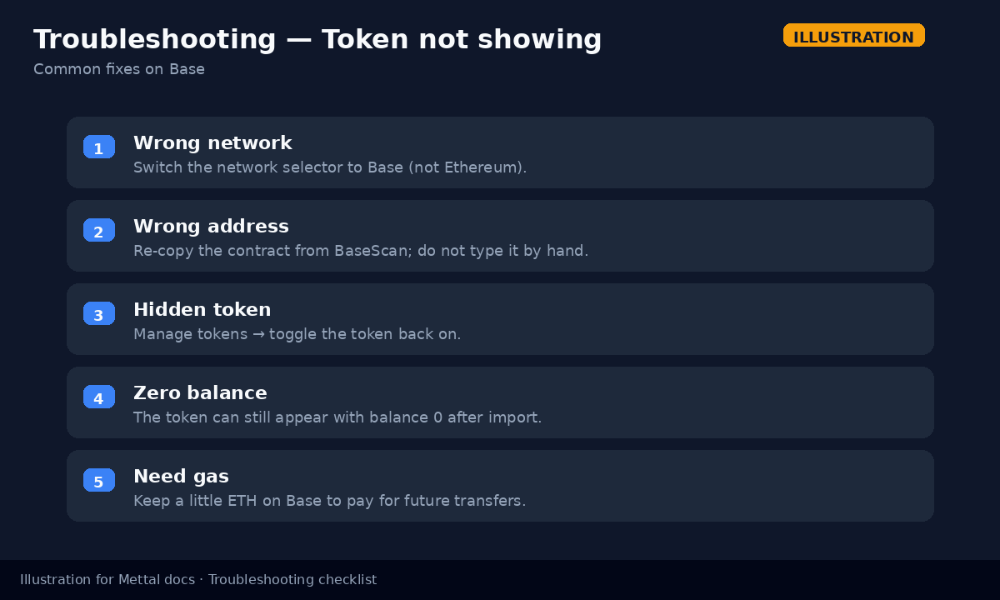

# How to add a custom token to MetaMask on Base

This guide shows how to display a custom ERC-20 token in [MetaMask](https://metamask.io/) on the **Base** network. It covers the **browser extension** and **MetaMask Mobile**, with an example using Mettal’s **PENMT** token on Base Mainnet.

> **Security:** Only import a token contract address from an official Mettal source or from [BaseScan](https://basescan.org) after you have verified the contract. Never paste an address from an unsolicited message, airdrop, or unknown website.

---

## What you need

- A MetaMask wallet (extension and/or mobile app)
- The **token contract address** on Base (not your wallet address)
- Optionally a small amount of **ETH on Base** if you plan to send the token later (gas)

---

## Example token: PENMT on Base

Mettal’s **PENMT Mettal** (`PENMT`) ERC-20 on Base Mainnet:

| Field | Value |
| --- | --- |
| Name | PENMT Mettal |
| Symbol | `PENMT` |
| Decimals | `6` |
| Contract (Base) | `0x862a1226E6EA04E34EA3ddB4346C7a2c693E06aB` |
| Explorer | [View on BaseScan](https://basescan.org/token/0x862a1226E6EA04E34EA3ddB4346C7a2c693E06aB) |

**Sources for this address**

1. [BaseScan token page](https://basescan.org/token/0x862a1226E6EA04E34EA3ddB4346C7a2c693E06aB) (name **PENMT Mettal**, symbol **PENMT**, 6 decimals)
2. Mettal backend config in [`mettal-stable/mettal-blockchain-backend-services`](https://github.com/mettal-stable/mettal-blockchain-backend-services) (`src/config.ts` → `chains.base.tokenContracts.PENMT`)

If you are adding a different Mettal asset (for example MXND), replace the address with the official contract for that token on Base. Do not invent or guess addresses.

For any other custom token, use the same steps with that token’s Base contract address in the placeholder form:

```text
<MTTL_CONTRACT_ADDRESS_ON_BASE>
```

---

## Base Mainnet network details

Always confirm these against the official Base documentation: [Connect to Base](https://docs.base.org/get-started/connect-to-base).

| Field | Value |
| --- | --- |
| Network name | Base |
| RPC URL | `https://mainnet.base.org` |
| Chain ID | `8453` |
| Currency symbol | `ETH` |
| Block explorer URL | `https://basescan.org` |

> MetaMask lists **Base** under supported / additional networks, so you can usually enable it with one click instead of typing the RPC by hand. Manual entry is still useful as a fallback or for verification.



*Illustration for Mettal docs (not a real MetaMask screenshot). Network values from [docs.base.org](https://docs.base.org/get-started/connect-to-base).*

---

## Part A — Browser extension

### 1. Install or open MetaMask

1. Install MetaMask only from the official site: [https://metamask.io](https://metamask.io) (or the official Chrome / Firefox / Brave / Edge store listing linked from there).
2. Open the extension and unlock your wallet.



*Illustration for Mettal docs (not a real MetaMask screenshot).*

Official MetaMask help on displaying tokens (extension and mobile): [How to display tokens in MetaMask](https://support.metamask.io/manage-crypto/tokens/how-to-display-tokens-in-metamask/).



*Source: [MetaMask Help Center — How to display tokens in MetaMask](https://support.metamask.io/manage-crypto/tokens/how-to-display-tokens-in-metamask/) (hero image from MetaMask support CDN).*

### 2. Add or enable the Base network

1. Open MetaMask and click the **network** selector (top of the wallet).
2. Open **Networks** (menu → Networks, depending on your MetaMask version).
3. Under **Additional networks**, find **Base** and click **Add**.
4. Confirm if MetaMask asks you to approve adding the network.

**Manual fallback** (if Base is not listed): choose **Add a custom network** and enter the Base Mainnet values from the table above. Double-check **Chain ID `8453`**.

Official MetaMask help: [How to add a network](https://support.metamask.io/configure/networks/how-to-add-a-custom-network-rpc/).

### 3. Switch to Base

1. Open the network dropdown again.
2. Select **Base**.
3. Confirm the wallet UI shows you are on Base (not Ethereum Mainnet).



*Illustration for Mettal docs (not a real MetaMask screenshot).*

### 4. Import the custom token by contract address

MetaMask often auto-detects popular tokens. Custom or newly deployed tokens may need a manual import.

1. Stay on the **Base** network.
2. On the Tokens / assets area, open **Manage tokens** (⋯ menu) or the control that lets you add a token.
3. Scroll to **Add custom token** (wording can vary slightly by version).
4. Paste the **token contract address** (for PENMT: `0x862a1226E6EA04E34EA3ddB4346C7a2c693E06aB`).
5. Wait for **symbol** and **decimals** to auto-fill (PENMT → `PENMT`, `6`). If they do not, fill them carefully from BaseScan — never from a stranger.
6. Click **Next**, review the details, then **Import**.



*Illustration for Mettal docs (not a real MetaMask screenshot). Example uses the PENMT Base address above.*

The token should now appear in your Tokens list on Base. A balance of `0` is normal until you receive tokens.

### 5. Verify the contract on BaseScan

Before you send or approve anything:

1. Open [BaseScan](https://basescan.org).
2. Paste the contract address in the search box.
3. Confirm **Token** name, **symbol**, and **decimals** match what MetaMask showed.
4. Prefer contracts with verified source code when available.



*Illustration styled after BaseScan. Always verify live data on [basescan.org](https://basescan.org/token/0x862a1226E6EA04E34EA3ddB4346C7a2c693E06aB).*

Optional: on many explorers you can use **Add token to MetaMask (Web3)** from the token page’s **More** menu. Still confirm you are connected to **Base** first.

---

## Part B — MetaMask Mobile

UI labels can differ slightly between iOS and Android, but the flow is the same idea.

1. Install MetaMask Mobile from the official App Store / Google Play listing linked from [metamask.io](https://metamask.io).
2. Unlock the app.
3. Open the **network** selector and add/enable **Base**, then switch to it (same network details as above).
4. On the **Tokens** tab, tap **+** (import / add token).
5. Search by name if listed; otherwise open the **Custom token** tab.
6. Paste the Base **contract address**, confirm symbol and decimals, then **Next** → **Import**.



*Illustration for Mettal docs (not a real MetaMask Mobile screenshot).*

> Networks added on the extension are **not** automatically synced to mobile (and vice versa). Add Base on each device you use.

---

## Finding a token contract address safely

1. Prefer Mettal’s official documentation, dashboard, or GitHub org announcements.
2. Or look up the token on [BaseScan](https://basescan.org) and copy the contract from the token page.
3. MetaMask’s own guide: [How to find a token contract address](https://support.metamask.io/manage-crypto/tokens/how-to-find-a-token-contract-address/).

Never use an address from:

- Cold messages (Telegram, WhatsApp, email, X DMs)
- “Support” accounts that message you first
- Random airdrops that appear in your wallet



*Illustration for Mettal docs — security reminder.*

---

## Troubleshooting



*Illustration for Mettal docs.*

### Token not showing

- Confirm the network selector is set to **Base**, not Ethereum or another chain.
- Re-import via **Add custom token** with the exact Base contract address.
- Open **Manage tokens** and make sure the token is toggled **on** (not hidden).
- Refresh the asset list (⋯ → refresh, if available).
- A zero balance still means the token can be listed after a successful import.

### Wrong network

- Assets are per-network. PENMT on Base will not appear while you are on Ethereum Mainnet.
- Chain ID for Base Mainnet must be **8453**. If you added a custom RPC with the wrong chain ID, remove it and re-add Base from official details.

### Symbol / decimals look wrong

- Delete/hide the bad entry and re-import.
- Copy the address again from BaseScan; do not type it manually.
- If MetaMask warns that the token is unrecognised, treat that as a prompt to re-verify the address — not as permission to ignore mismatches.

### Scam-token or “unrecognised token” warning

- MetaMask may warn about tokens that are not on popular lists. That does **not** prove a token is safe.
- Compare the contract to the official Mettal / BaseScan sources in this guide.
- Do **not** approve spending (`approve`) for unknown tokens or unknown websites.
- Ignore links inside failed-transaction error messages that push you to “claim” or “validate” wallets — those are common phishing patterns (also noted in MetaMask’s token help article).

### You can see the token but cannot send it

- You need **ETH on Base** to pay gas for ERC-20 transfers.
- Bridge or buy ETH on Base through a method you trust; Mettal does not require you to use any specific bridge for this guide.

### Still stuck?

- Re-read [How to display tokens in MetaMask](https://support.metamask.io/manage-crypto/tokens/how-to-display-tokens-in-metamask/)
- Confirm Base details on [docs.base.org](https://docs.base.org/get-started/connect-to-base)
- Confirm the token page on BaseScan before contacting Mettal support

---

## Quick checklist

- [ ] MetaMask installed from an official source  
- [ ] Base enabled / added (chain ID `8453`)  
- [ ] Network switched to **Base**  
- [ ] Contract address copied from BaseScan or Mettal official docs  
- [ ] Symbol and decimals match the explorer  
- [ ] Token visible under Tokens on Base  

---

## References

- Base — [Connect to Base](https://docs.base.org/get-started/connect-to-base)
- MetaMask — [How to display tokens in MetaMask](https://support.metamask.io/manage-crypto/tokens/how-to-display-tokens-in-metamask/)
- MetaMask — [How to add a network](https://support.metamask.io/configure/networks/how-to-add-a-custom-network-rpc/)
- MetaMask — [How to find a token contract address](https://support.metamask.io/manage-crypto/tokens/how-to-find-a-token-contract-address/)
- BaseScan — [PENMT Mettal token](https://basescan.org/token/0x862a1226E6EA04E34EA3ddB4346C7a2c693E06aB)
- Mettal — [mettal.io](https://www.mettal.io/)

---

*Images marked “Illustration” were created for this documentation and are not official MetaMask or Base screenshots. The MetaMask Help Center hero image is credited to MetaMask support.*
