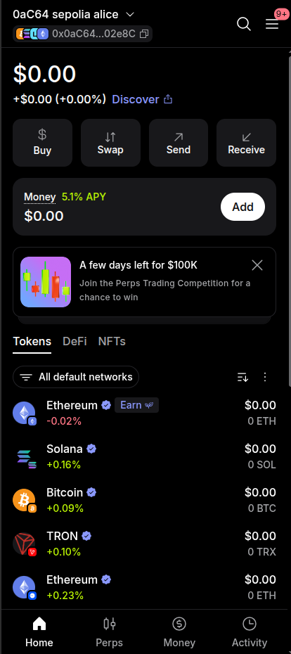
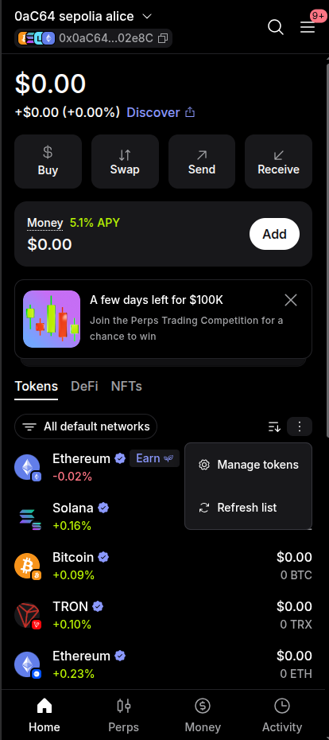
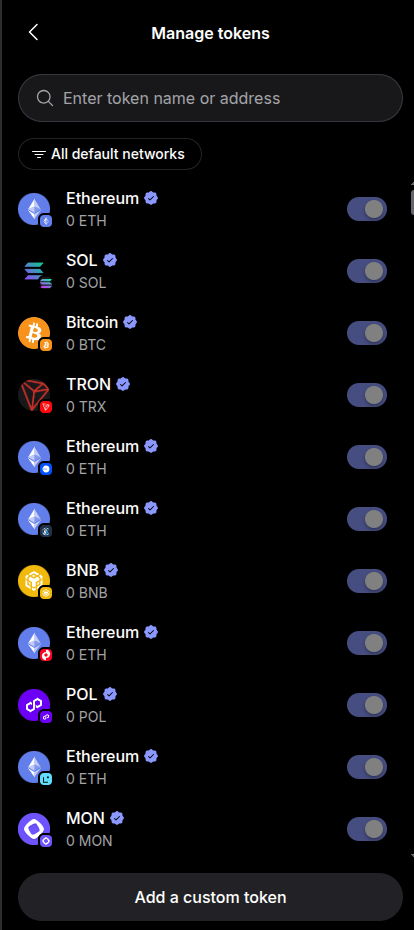
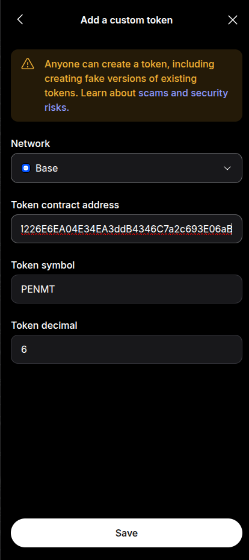

🇬🇧 [Read in English](add-custom-token-metamask-base.md)

# Agregar un token personalizado a MetaMask en Base

Esta guía muestra cómo agregar un token de Mettal (ejemplo: **PENMT**) a MetaMask en la red **Base**, para que aparezca en tu lista de tokens. Asume que ya tienes MetaMask instalado y configurado.

**Datos del token (Base Mainnet)**

| Campo | Valor |
| --- | --- |
| Red | Base |
| Dirección del contrato del token | `0x862a1226E6EA04E34EA3ddB4346C7a2c693E06aB` |
| Símbolo del token | `PENMT` |
| Decimales del token | `6` |

Puedes confirmar estos datos en [BaseScan](https://basescan.org/token/0x862a1226E6EA04E34EA3ddB4346C7a2c693E06aB).

---

## Paso 1: Abrir MetaMask en la pestaña Tokens

Abre MetaMask y asegúrate de estar en la pestaña **Tokens** de la pantalla de inicio.

## Paso 2: Abrir el menú de opciones de tokens

Toca el **menú de tres puntos** (⋮) a la derecha de la lista de tokens y elige **Manage tokens**.

## Paso 3: Elegir "Add a custom token"

En la pantalla **Manage tokens**, toca **Add a custom token** abajo de todo.

## Paso 4: Ingresar los datos del token y guardar

1. En **Network**, selecciona **Base**.
2. Pega la **Token contract address**: `0x862a1226E6EA04E34EA3ddB4346C7a2c693E06aB`
3. Verifica que **Token symbol** muestre `PENMT` y **Token decimal** muestre `6`. Normalmente se completan solos al pegar la dirección. Si no, escríbelos.
4. Toca **Save**.

Listo. **PENMT** ya aparece en tu lista de tokens en Base.

---

## Consejos

- **Usa solo la dirección oficial.** Cualquiera puede crear un token con el mismo nombre o símbolo, por eso MetaMask muestra una advertencia en esta pantalla. Copia siempre la dirección del contrato desde esta guía u otra fuente oficial de Mettal.
- **¿No ves el token?** Asegúrate de que el filtro de redes arriba de la lista de tokens incluya Base y luego usa **Refresh list** desde el mismo menú de tres puntos.
- **¿El símbolo o los decimales no se completaron?** Revisa que **Base** esté seleccionada como red y que la dirección se haya pegado completa.
