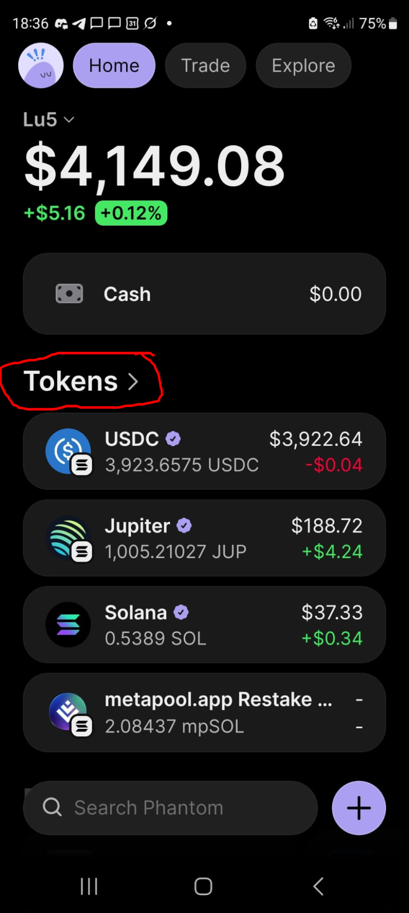
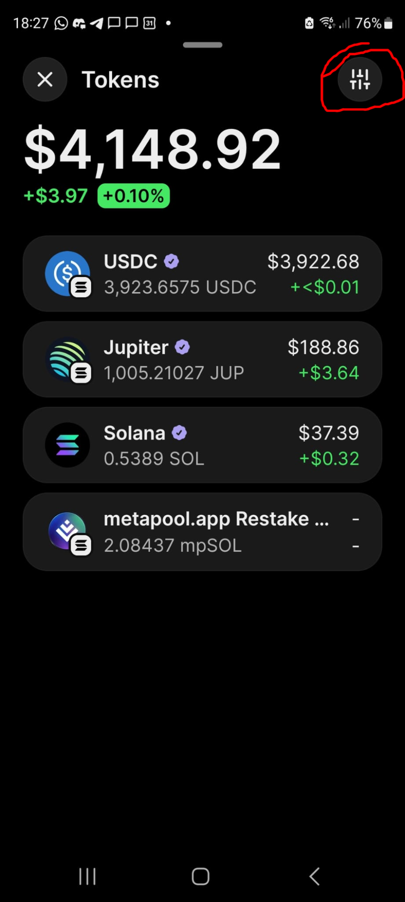
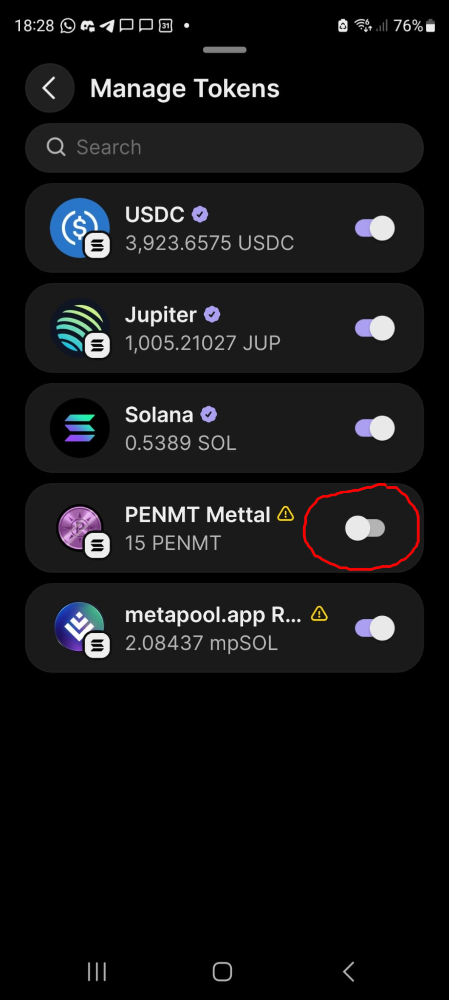
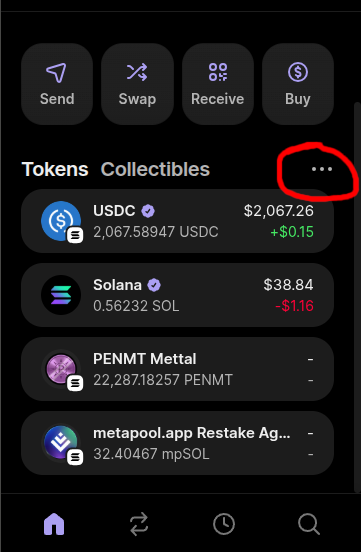
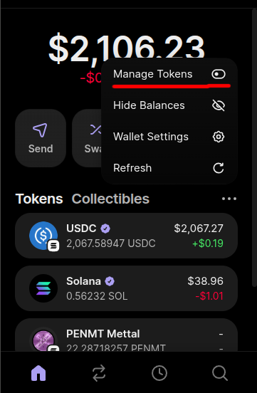
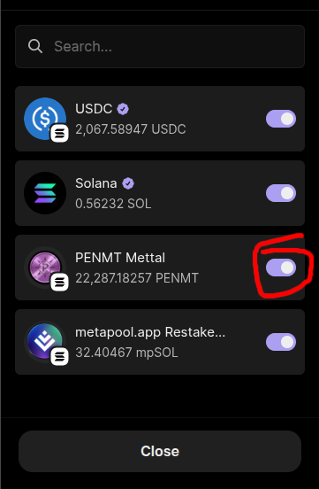

🇬🇧 [Read in English](phantom-tokens-not-showing.md)

# Mis tokens no aparecen en Phantom Wallet

Si tienes **PENMT** (Mettal) en Phantom pero no aparece en tu lista de tokens, lo más probable es que esté oculto. Phantom puede ocultar tokens que no reconoce, así que solo tienes que volver a habilitar PENMT.

## Phantom Mobile

### Paso 1: Abrir tus tokens
En la pantalla de inicio, toca **Tokens >**.

### Paso 2: Abrir los ajustes de tokens
Toca el ícono de **ajustes** arriba a la derecha.

### Paso 3: Habilitar PENMT
En **Manage Tokens**, activa **PENMT Mettal**.

## Phantom Extension (escritorio)

### Paso 1: Abrir el menú de tokens
Haz clic en el **menú de tres puntos** (…) junto a **Tokens**.

### Paso 2: Elegir Manage Tokens
Haz clic en **Manage Tokens**.

### Paso 3: Asegurarse de que PENMT esté habilitado
Verifica que el interruptor junto a **PENMT Mettal** esté activado y luego haz clic en **Close**.

Listo. PENMT ya aparece en tu lista de tokens.
