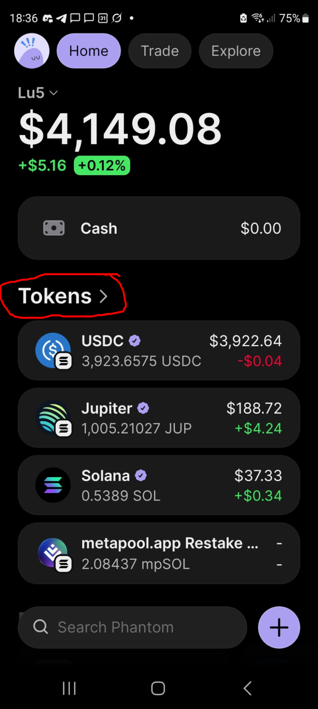
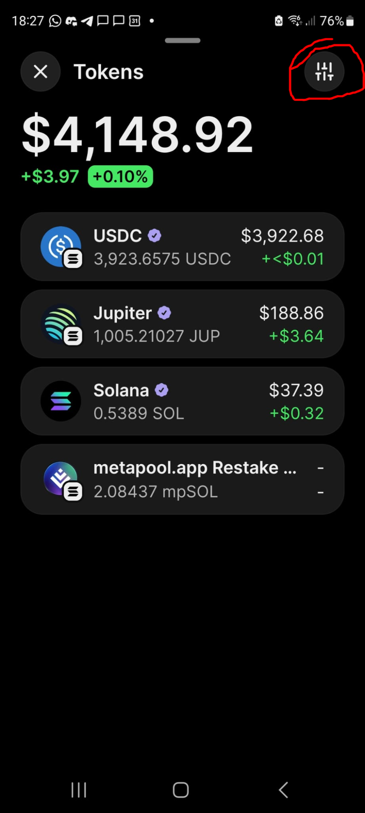
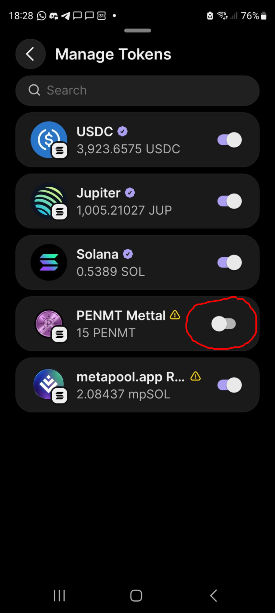
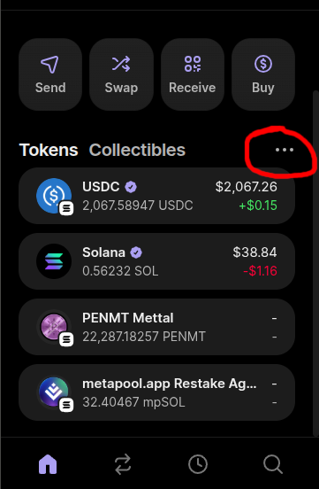
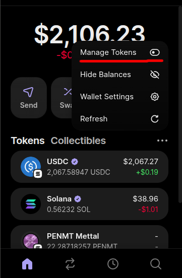
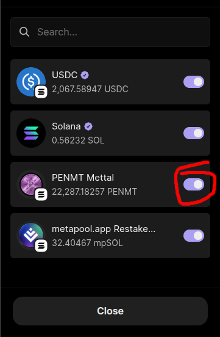

🇪🇸 [Leer en español](phantom-tokens-no-aparecen.md)

# My tokens don't show up in Phantom Wallet

If you hold **PENMT** (Mettal) in Phantom but it doesn't appear in your token list, it's usually hidden. Phantom can hide tokens it doesn't recognize, so you just need to turn PENMT back on.

## Phantom Mobile

### Step 1: Open your tokens
On the Home screen, tap **Tokens >**.

### Step 2: Open token settings
Tap the **settings** icon in the top right.

### Step 3: Turn on PENMT
In **Manage Tokens**, switch on **PENMT Mettal**.

## Phantom Extension (desktop)

### Step 1: Open the tokens menu
Click the **three-dot menu** (…) next to **Tokens**.

### Step 2: Choose Manage Tokens
Click **Manage Tokens**.

### Step 3: Make sure PENMT is turned on
Check that the switch next to **PENMT Mettal** is on, then click **Close**.

That's it. PENMT now shows up in your token list.
